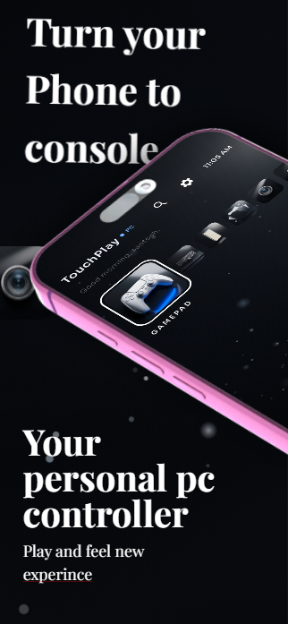
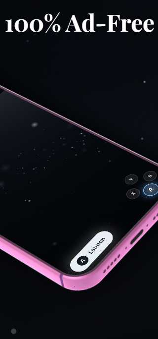

# TouchPlay

  
  

**Turn your Android phone into a real gamepad, trackpad, and second screen for any PC game.**

This repository hosts the official PC server releases for TouchPlay, the official website, and serves as our public issue tracker.

---

## 🚀 Quick Download & Setup

### 📱 Android Phone App

**[Get TouchPlay on Google Play](https://play.google.com/store/apps/details?id=com.touchplay.app)**

The Android app is distributed **only** through Google Play. There is no APK
download here — Play handles the install and every future update. The app also
tells you inside when a new version is available.

---

### 💻 PC Server (Windows & Linux)

| Platform | How to Run | Highlights |
| :--- | :--- | :--- |
| **🪟 Windows (10 / 11)** | Download and run [**TouchPlay-Server.exe**](https://github.com/shantoshdurai/touchplay-releases/releases/latest/download/TouchPlay-Server.exe) | Bundled ViGEmBus driver, GUI window with drag-and-drop, tray support |
| **🐧 Linux (Arch / Ubuntu / Fedora / Omarchy)** | Download [**touchplay-linux-source.tar.gz**](https://github.com/shantoshdurai/touchplay-releases/releases/latest/download/touchplay-linux-source.tar.gz), extract, then `./setup.sh` and `./TouchPlay-Server.sh` | Native `/dev/uinput` evdev, Wayland (`grim`) & X11 capture, Rich terminal dashboard, `touchplay-send` CLI |

A prebuilt single-file Linux binary, `TouchPlay-Server-Linux`, is attached to each
tagged release as well, for machines that would rather not run Python.

> **Linux requires Python 3.10+**, the `python3-venv` package, and your user in the
> `input` group (`sudo usermod -aG input "$USER"`, then log out and back in) so the
> virtual gamepad can open `/dev/uinput`. `setup.sh` checks all of this and tells you
> exactly what to fix if something is missing.

---

## ⚖️ Platform Differences: Windows vs Linux

| Feature | 🪟 Windows | 🐧 Linux |
| :--- | :--- | :--- |
| **Server Interface** | Minimal GUI window with drag-and-drop | Performance terminal dashboard (Rich TUI) |
| **Gamepad Driver** | Bundled ViGEmBus (Xbox 360 & DualShock 4) | Kernel `/dev/uinput` (evdev native, zero install) |
| **Screen Streaming** | DirectX Desktop Duplication (DXGI) | Wayland via `grim` on wlroots (Hyprland/Sway); `mss` on X11 and GNOME/KDE Wayland |
| **Virtual 2nd Display** | Bundled usbmmidd virtual display | Headless Wayland output (`phone-display` in Hyprland) |
| **Media / File Drop** | `%USERPROFILE%\Downloads\TouchPlay` (GUI drop-zone) | `~/Downloads/TouchPlay` + `touchplay-send` CLI tool |

Both platforms support **8 players**: slots 1-4 appear as Xbox 360 pads, and slots
5-8 as DualShock 4 pads, because Windows only exposes four XInput slots.

---

## 🔒 A note on networking

TouchPlay has **no authentication**. It trusts your local network. Don't run the
server on shared or public Wi-Fi. See `server/README.md` in the source for the
full details, including the browser-origin protections that stop a web page from
driving your desktop.

---

## 🌐 Official Website

Visit our live download portal at [**shantoshdurai.github.io/touchplay-releases**](https://shantoshdurai.github.io/touchplay-releases/).

## 💬 Support & Feedback

- Have an idea or need help? Join the [Discussions](https://github.com/shantoshdurai/touchplay-releases/discussions).
- Found a bug? Open an [Issue](https://github.com/shantoshdurai/touchplay-releases/issues).
